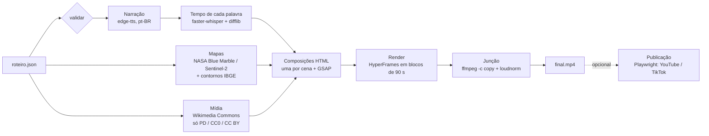

# Pipeline de Vídeo com IA

Pipeline em Python que transforma um **roteiro em JSON** num **vídeo explicativo 16:9 pronto para publicar**: narração neural em português, legendas palavra a palavra sincronizadas com a fala, mapas de satélite com contornos animados, fotos e vídeos de licença livre, render para MP4 e, opcionalmente, publicação automática no YouTube e no TikTok.

O objetivo foi produzir vídeos longos (cerca de 8 a 9 minutos) com qualidade de motion graphics **sem editor de vídeo**: tudo o que aparece na tela é descrito no roteiro e sincronizado automaticamente com a palavra falada.

[](../../actions/workflows/ci.yml)

## Como funciona



| Etapa | O que faz | Tecnologia | Código |
|---|---|---|---|
| Roteiro | Cenas com narração, fundo (mapa, foto, vídeo) e peças que entram em palavras específicas | JSON + validação própria | `pipeline/roteiro.py` |
| Narração | Uma faixa de voz por cena, com silêncio uniforme nas pontas | edge-tts (voz neural pt-BR), numpy, ffmpeg | `pipeline/tts.py` |
| Tempos | Início e fim de cada palavra do roteiro | faster-whisper (`word_timestamps`) + alinhamento com difflib | `pipeline/legendas.py` |
| Mapas | Fundo de satélite 3840x2160 costurado de tiles Web Mercator, projeção lon/lat para pixel, contornos de UF/município | Pillow, urllib, API de malhas do IBGE | `pipeline/mapas.py` |
| Mídia | Busca no Commons filtrando licença, folha de miniaturas para escolher, recorte do trecho de vídeo | API MediaWiki, ffmpeg | `pipeline/midia.py` |
| Composição | Uma composição HTML por cena (pin, seta, contorno, contador, cartões, cortes de b-roll), legendas, efeitos sonoros e música | HTML/SVG + GSAP, formato HyperFrames | `pipeline/cenas.py`, `pipeline/montar.py`, `pipeline/runtime/` |
| Render | HTML para MP4 em blocos e junção sem recodificar | HyperFrames (via `npx`), ffmpeg/ffprobe | `pipeline/render.py` |
| Publicação (opcional) | Upload, título, descrição, miniatura e visibilidade | Playwright (Chrome com perfil local) | `publicar/` |

## Problemas de engenharia resolvidos

**Render que enchia o disco.** O HyperFrames grava quadros temporários de cerca de 1,25 MB cada em 1080p. Num vídeo de 8 minutos, o render falhou com `ENOSPC` perto do quadro 13.600. A solução foi renderizar em blocos de 90 s (`--start/--end`), pulando os blocos já prontos, e juntar no fim:
- o vídeo é emendado com o *concat demuxer* e `-c copy`, sem recodificar;
- o áudio de cada parte é cortado ou completado na duração exata do vídeo dela, medida contando quadros com `ffprobe -count_packets`. Sem isso, o atraso do AAC acumula a cada emenda e a voz sai de sincronia;
- o áudio emendado é normalizado em -14 LUFS uma vez só.

**Refazer só o que mudou.** Editar uma frase do roteiro não pode custar o vídeo inteiro de novo. A voz de cada cena fica gravada ao lado do texto que a gerou (`voz_NN.txt`), e os tempos do Whisper ficam num cache por cena (`tmp/palavras.json`). Só as cenas cujo texto mudou passam de novo pelo TTS e pelo Whisper.

**Legenda com o texto certo no tempo certo.** O Whisper pode escrever "1960" onde o roteiro diz "mil novecentos e sessenta", ou não ouve uma palavra. Por isso a legenda nunca usa a transcrição. As palavras ouvidas são casadas com as do roteiro por posição (`difflib.SequenceMatcher`), e uma palavra sem par ganha um tempo interpolado entre as vizinhas. As legendas são agrupadas em até 4 palavras. Elas quebram em pontuação ou pausa, nunca terminam em palavra de ligação ("de", "para", "o"…) e não deixam uma palavra sozinha no fim.

**Sincronizar animação com a fala, não com segundos.** No roteiro, cada peça diz *em qual palavra* entra (`"em": "Rio de Janeiro"`, com `n` para a n-ésima ocorrência). Se a narração for regravada com outro ritmo, tudo continua sincronizado sem mexer no roteiro. Uma âncora inexistente falha na hora, com a frase da cena na mensagem.

**Licença de mapa e mídia como regra de código, não de memória.**
- A camada Sentinel-2 fixa a edição 2016 do s2cloudless (CC BY 4.0). As edições de 2018 em diante são não comerciais.
- A busca no Commons aceita só domínio público, CC0 e CC BY. SA, NC e ND são descartadas por regex, e isso é coberto por testes.
- O crédito de cada mídia é gravado em `fontes/creditos-midia.json` e aparece na tela durante o corte.

**Mapas sem buracos e sem borrão.**
- Tiles de oceano sem imagem (respostas com menos de 1 KB) são pintados com a cor do mar e marcados no cache, para não serem baixados de novo.
- Se mais da metade dos tiles vier vazia, a execução para: é sinal de camada ou zoom errado.
- O fundo é gerado em 2x (3840x2160), então a câmera pode dar zoom de até 2x sem perder nitidez.

**Rate limit do Wikimedia.** O Commons responde 429 sem um User-Agent identificável e sob rajadas de requisições. Por isso o pipeline manda um User-Agent configurável e faz *backoff* crescente.

**Automação de navegador que clicava no elemento errado.**
- No YouTube Studio, `get_by_text('Público').first` resolvia para um *tooltip* invisível que vinha antes do controle real no DOM, e o `click()` esperava 30 s até estourar o tempo.
- A correção foi iterar as ocorrências e clicar só na primeira com `is_visible()`.
- Se algum passo falhar depois do upload, a janela fica aberta (`page.pause()`) para terminar à mão, sem reenviar um arquivo de vários GB.

**Voz com sotaque certo.** Antes, a narração vinha de um modelo de clonagem de voz, que em parte das frases saía com sotaque de Portugal. A troca para uma voz neural pt-BR nativa resolveu isso por construção.

## Como rodar

Requisitos: Python 3.12, `ffmpeg`/`ffprobe` no PATH e Node.js (para o `npx hyperframes` no render).

```bash
python -m venv .venv
source .venv/bin/activate        # Windows: .venv\Scripts\activate
pip install -r requirements.txt

# 1) conferir o roteiro (sem rede, sem GPU)
python -m pipeline validar exemplos/roteiro-exemplo.json

# 2) montar o projeto: voz, Whisper, mapas e composições
mkdir -p saida/exemplo && cp exemplos/roteiro-exemplo.json saida/exemplo/roteiro.json
python -m pipeline montar saida/exemplo

# 3) renderizar em blocos de 90 s e juntar em saida/exemplo/final.mp4
python -m pipeline render saida/exemplo
```

Para conferir antes de renderizar, rode `npx hyperframes preview` dentro de `saida/exemplo/video`.

Fotos e vídeos do Commons (opcional):

```bash
python -m pipeline midia busca saida/exemplo buscas.json      # gera folhas de miniaturas numeradas
python -m pipeline midia baixa saida/exemplo escolhas.json    # baixa as escolhidas + créditos
```

Publicação (opcional, exige `pip install playwright` e Chrome instalado):

```bash
python publicar/youtube.py saida/exemplo/final.mp4 "Título" descricao.txt --privado
python publicar/tiktok.py saida/exemplo/final.mp4 "legenda #tag"
```

Os scripts não guardam credenciais. Na primeira execução você faz login na própria janela do navegador. A sessão fica num perfil local fora do repositório (`PUBLICAR_PERFIL`, padrão `~/.pipeline-video-ia/perfil-<rede>`), e antes de publicar há sempre uma pausa para revisão, a menos que você passe `--yes`.

### Configuração (variáveis de ambiente)

| Variável | Padrão | Para quê |
|---|---|---|
| `PIPELINE_CACHE` | `./cache` | Tiles de mapa e malhas do IBGE |
| `PIPELINE_UA` | genérico | User-Agent com contato (o Wikimedia pede isso) |
| `EDGE_VOZ`, `EDGE_RITMO`, `EDGE_TOM` | `pt-BR-AntonioNeural`, `-6%`, `-2Hz` | Voz da narração |
| `WHISPER_MODELO` | `small` | Modelo do faster-whisper (CPU, int8) |
| `FFMPEG`, `FFPROBE` | `ffmpeg`, `ffprobe` | Binários |
| `HYPERFRAMES` | `hyperframes@0.9.34` | Versão do pacote usada no render |
| `PUBLICAR_PERFIL` | `~/.pipeline-video-ia/perfil-<rede>` | Perfil do navegador da publicação |

### Música e efeitos sonoros (entradas opcionais)

O repositório **não inclui** áudio de terceiros. Para ter trilha e efeitos, use arquivos cuja licença você conheça:
- **Música:** ponha os arquivos citados em `"musicas"` em `<pasta>/musica/` ou passe `--musica DIR`. Uma faixa mais curta que o trecho repete, com 2 s de sobreposição.
- **Efeitos:** ponha `pop.mp3`, `click.mp3`, `whoosh.mp3`, `whoosh-short.mp3`, `impact-bass-1.mp3`, `impact-bass-2.mp3` e `sparkle.mp3` em `<pasta>/sfx/` ou passe `--sfx DIR`. Os efeitos entram sozinhos por tipo de peça, no máximo um a cada 0,22 s. Para alinhar o impacto de outros arquivos, crie `sfx.json` com `{"pop": {"pico": 0.12, "dur": 0.72}}`.
- **Sem essas pastas,** o vídeo sai só com a narração.

## Formato do roteiro

Exemplo completo em [`exemplos/roteiro-exemplo.json`](exemplos/roteiro-exemplo.json):

```json
{
  "pergunta": "POR QUE A CAPITAL FICA NO **CENTRO**?",
  "vistas": {"brasil": {"centro": [-54.0, -15.0], "zoom": 4.95, "camada": "bm"}},
  "cenas": [
    {"capitulo": {"n": 1, "titulo": "...", "pergunta": "..."},
     "narracao": "texto falado (até umas 30 palavras por cena)",
     "fundo": {"tipo": "mapa", "vista": "brasil", "ufs": true},
     "fx": [{"em": "Rio de Janeiro", "tipo": "pin", "lnglat": [-43.2, -22.9], "rotulo": "Rio de Janeiro"}]}
  ]
}
```

**Vistas:**
- `zoom` é contado em tiles de 256 px: 4,95 mostra o Brasil inteiro, 9 mostra o DF.
- `camada` é `bm` (Blue Marble, até z8) ou `s2` (Sentinel-2, até z14).

**`fundo`:**
- `mapa`: `vista`, `ufs` (divisas estaduais), `empurra` (câmera lenta automática).
- `foto`: `img` em `video/assets/fotos`, `fonte`, `ajuste: cobre|contem`, `kb: in|out`.
- `video`: `src` em `video/assets/videos`, `fim`.
- `papel`: fundo escuro.

**`em`:**
- É a palavra ou frase falada em que a peça entra.
- Aceita também `n` (qual ocorrência), `desl` (ajuste em segundos), um número (segundos) ou `^` (início da cena).
- `ate` faz a peça sair em outra palavra.

**Peças na tela:**
- Tipos: `chip`, `cartao`, `doc` (citação), `carimbo`, `numero` (contador), `lista`/`risca`, `polaroid`, `compara`, `corte` (b-roll do Commons), `som`, `sai`.
- Posições: `esq`, `esq2`, `dir`, `dir2`, `topo`, `centro`, `baixo` ou `xy`.
- Uma peça nova no mesmo lugar tira a anterior; `fica: true` segura a anterior na tela.

**Peças no mapa:**
- Tipos: `contorno` (`geo: uf:DF | mun:<código> | meso:<código> | micro:<código>`), `poligono`, `linha`, `seta`, `pin`, `anel`, `rotulo`, `camera`.
- Cores: `am`, `vm`, `az`, `vd`, `br`, `lj`.

**Capítulo:** abre com um cartão de 2,1 s antes da voz. A `pergunta` do capítulo fica fixa no topo até o próximo.

## Estrutura

```
pipeline/
  __main__.py   CLI (validar, montar, midia, render)
  config.py     variáveis de ambiente
  roteiro.py    validação do roteiro
  tts.py        narração por cena (edge-tts)
  legendas.py   Whisper, alinhamento com o roteiro, grupos de legenda
  mapas.py      tiles Web Mercator, projeção, malhas do IBGE
  midia.py      busca e download no Wikimedia Commons
  cenas.py      composição HTML/GSAP de cada cena
  montar.py     orquestra tudo e gera o projeto HyperFrames
  render.py     render em blocos + junção
  runtime/      kit.js (animações) e tema.css
publicar/       youtube.py e tiktok.py (opcionais, Playwright)
exemplos/       roteiro-exemplo.json
tests/          testes de lógica pura (sem rede, GPU nem ffmpeg)
```

## Testes

```bash
pip install pytest
pytest
```

Os testes cobrem a lógica pura e rodam com nada além do `pytest`:
- projeção lon/lat → pixel e lon/lat → tile, conferida contra a fórmula de referência do OpenStreetMap;
- simplificação de contornos;
- alinhamento Whisper → roteiro com interpolação;
- agrupamento de legendas;
- busca de âncoras;
- filtro de licenças do Commons;
- validação do roteiro;
- divisão do render em blocos;
- geração de uma cena.

Os imports pesados (Whisper, edge-tts, Pillow, numpy) são feitos dentro das funções que os usam. O CI roda em Ubuntu com Python 3.12.

## Licenças das fontes

| Fonte | Licença | Crédito |
|---|---|---|
| NASA Blue Marble (GIBS) | Domínio público (imagens da NASA) | "NASA Blue Marble (GIBS)", aplicado automaticamente na tela |
| Sentinel-2 cloudless **2016** (EOX) | CC BY 4.0 | "Sentinel-2 cloudless 2016 by EOX IT Services GmbH (Contains modified Copernicus Sentinel data 2016)", aplicado automaticamente |
| Malhas territoriais do IBGE | Dados públicos; citar a fonte | "Malhas: IBGE", aplicado automaticamente quando há contorno |
| Wikimedia Commons | Por arquivo; o filtro aceita só domínio público, CC0 e CC BY | Autor e licença em `fontes/creditos-midia.json` e na tela |
| edge-tts | Usa o serviço de leitura em voz alta do navegador; os termos para uso comercial não são claros | Para uso comercial, troque a função `fala` em `pipeline/tts.py` por um TTS com licença explícita |
| GSAP | Carregado via CDN no HTML gerado | — |

Código sob licença [MIT](LICENSE).
